<picture>
  <source media="(prefers-color-scheme: light)" srcset="assets/hero-light.svg">
  
</picture>

 

<b>Contents</b>

- [At a glance](#at-a-glance)
- [Skills](#skills)
- [Featured projects](#featured-projects)
- [Experience](#experience)
- [Other projects](#other-projects)
- [Education](#education)
- [Activity](#activity)

## At a glance

<picture>
  <source media="(prefers-color-scheme: light)" srcset="assets/stats-light.svg">
  
</picture>

## Skills

<picture>
  <source media="(prefers-color-scheme: light)" srcset="assets/marquee-light.svg">
  
</picture>

| Area | Stack |
|---|---|
| **Data Science & Analytics** | `Python` `SQL` `Pandas` `NumPy` `Matplotlib` `Seaborn` `PostgreSQL` `Scikit-Learn` `Exploratory data analysis` `Model evaluation` `Feature engineering` |
| **ML & AI** | `PyTorch` `TensorFlow/Keras` `Hugging Face` `Sentence Transformers` `LangChain` `LangGraph` `OpenAI API` `RAG pipelines` `CNNs` `NLP` `Agentic workflows` |
| **Backend & DevOps** | `FastAPI` `Docker` `GitHub Actions` `AWS EC2` `n8n` `Vercel` `Render` `WebSockets` `JWT auth` |
| **Frontend** | `React` `TypeScript` `Vite` `Tailwind CSS` `shadcn/ui` |
| **Databases** | `PostgreSQL` `Supabase` `MongoDB` |
| **Languages** | `Python` `C++` `Java` `TypeScript` `Go` `SQL` |

## Featured projects

### Chronicle: Durable Agent Runtime + Time-Travel Debugger

**Status: `LIVE`** (shipped)

<picture>
  <source media="(prefers-color-scheme: light)" srcset="assets/chronicle-flow-light.svg">
  
</picture>

- Agent runs are persisted as a durable event log in PostgreSQL, so a run survives crashes: kill a worker mid-run and another worker resumes from the log.
- A time-travel debugger lets you scrub a run's timeline and replay or inspect any step.
- RepoPilot is the demo agent: it reads a codebase and fixes an issue.
- Built-in evals with a regression gate, plus benchmarks. The gate fails when a single word of the agent prompt changes.

| Worker kills survived | Duplicated side effects | Runtime checks passed |
|:---:|:---:|:---:|
| **200** real kills, 144 runs | **0** across 1,112 keyed effects | **8 of 8** |

*Measured on one Windows 11 machine with PostgreSQL 16 in Docker.*

**Stack:** `Python` `PostgreSQL` `Docker` `OpenAI-compatible LLM endpoint` `React` `TypeScript`

 

### Mini LLM Inference Server

**Status: `IN PROGRESS`** (with an optional routing layer on top)

<picture>
  <source media="(prefers-color-scheme: light)" srcset="assets/inference-flow-light.svg">
  
</picture>

- Request batching across concurrent requests
- KV-cache management
- Streaming token output
- Latency and throughput benchmarking
- Optional model router

 

### Raft Cluster + Jepsen-style Checker

**Status: `PLANNED`** (distributed systems track; alternative: Retrieval Lab)

<picture>
  <source media="(prefers-color-scheme: light)" srcset="assets/raft-flow-light.svg">
  
</picture>

## Experience

<picture>
  <source media="(prefers-color-scheme: light)" srcset="assets/experience-light.svg">
  
</picture>

- Architected a production RAG pipeline (vector search + PostgreSQL trigram fuzzy matching), ~95% retrieval accuracy across 50+ service/pricing queries.
- Built an Instagram DM auto-response system (GPT-4.1-mini + n8n agentic workflows), cutting average reply time from 20 minutes to under 30 seconds.
- Deployed on a VPS with webhooks and real-time session state across concurrent conversations, 100+ queries/month in production.

## Other projects

<b>SAGE</b>: Smart Agentic Grading & Evaluation System &nbsp;·&nbsp; <code>LangGraph</code> <code>FastAPI</code> <code>React 19</code>

- 5-agent LangGraph state graph (Greeter, Interviewer, Evaluator, Scorer, Reporter) running adaptive technical interviews.
- Real-time voice loop with STT + TTS + GPT-4o over streaming WebSockets.
- FastAPI + React 19 + Vite + Tailwind, JWT auth, PostgreSQL; HR dashboard.

<b>ResumeIQ</b>: AI Resume & Job-Match Analyzer &nbsp;·&nbsp; <code>Sentence Transformers</code> <code>FastAPI</code> <code>Docker</code>

- 4-component weighted ATS scoring engine.
- Sentence Transformers (all-MiniLM-L6-v2) + NLP entity extraction.
- 81-skill taxonomy for gap analysis.
- Dockerized FastAPI + React app with PDF/DOCX parsing.

<b>Plant Disease CNN</b> &nbsp;·&nbsp; <code>TensorFlow/Keras</code> &nbsp;·&nbsp; 99.19% validation accuracy

- TensorFlow/Keras CNN trained on 87,000+ leaf images across 38 classes.
- 99.19% validation accuracy with a custom augmentation pipeline.

<b>SignBridge</b>: Real-Time ASL Alphabet Recognition &nbsp;·&nbsp; <code>MediaPipe</code> <code>PyTorch</code>

- MediaPipe hand landmarks feeding a PyTorch classifier, 29 gesture classes in real time.
- CI/CD with GitHub Actions, Docker, AWS EC2.

## Education

**B.Tech Computer Science (Data Science)**, Galgotias University, 2024–2028.

## Activity

<picture>
  <source media="(prefers-color-scheme: dark)" srcset="https://raw.githubusercontent.com/Chaitanaya25/Chaitanaya25/output/github-snake-dark.svg">
  
</picture>

