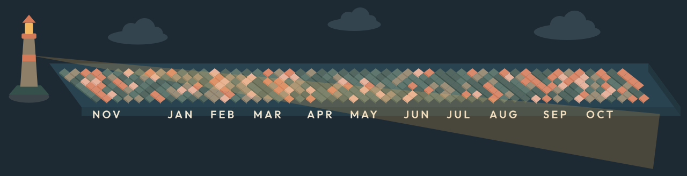
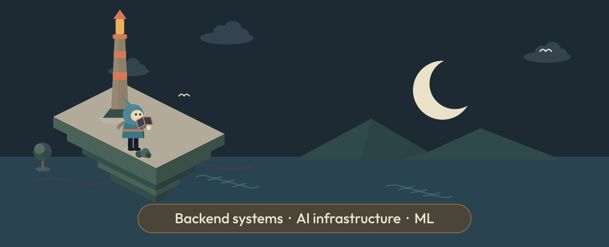

<picture>
  <source media="(prefers-color-scheme: light)" srcset="assets/hero-day.svg">
  
</picture>

   

I build backend systems, AI infrastructure and ML. Open to backend, ML and AI engineering internships.

[Portfolio](https://hypertos.in) · [LinkedIn](https://www.linkedin.com/in/chaitanaya052006) · [LeetCode](https://leetcode.com/u/Chaitanaya_25/) · [Email](mailto:Chaitanyasrivastava63@gmail.com)

## Chronicle: durable agent runtime

`LIVE` Python, PostgreSQL, Docker, React, TypeScript.

<picture>
  <source media="(prefers-color-scheme: light)" srcset="assets/chronicle-day.svg">
  
</picture>

Chronicle lets AI agents survive crashes, and be rewound like a video.

1. **Every step is logged.** Each agent step is appended to a PostgreSQL event log, in order, and the log only grows.
2. **A worker crashes.** Workers own a run through a lease with heartbeats. A crash leaves the log untouched.
3. **The lease runs out.** After the 3 s lease TTL another worker claims the run with a compare-and-swap; epoch fencing locks the old one out.
4. **The next worker resumes.** The run continues from the next step, with no lost or repeated steps.

- Time-travel debugger: replay, fork and diff any run. Replay checks recompute recorded LLM request hashes to catch prompt drift.
- CI regression gate: 8/8 deterministic runtime checks plus a 25-task eval suite. The build fails on any duplicated effect or behaviour change; a deliberately changed prompt made it fail. RepoPilot is the demo coding agent.

| Measure | Result |
|:--|:--|
| Chaos test | 200 worker kills across 144 runs, 0 duplicated side effects in 1,112 keyed effects |
| Recovery at a 3 s lease TTL | p50 3.027 s · p95 3.459 s · max 3.865 s |
| Event store | 481.5 events/s with 1 writer · 1,818 events/s with 4 writers (3.8x) |
| Append latency | p95 2.8 ms |

*Measured on one Windows 11 machine (28 logical CPUs), Python 3.12, PostgreSQL 16 in Docker. No model resolve rate is claimed; it has not been run.*

## Mini LLM inference server

`IN PROGRESS` Python, PyTorch, Hugging Face Transformers, FastAPI.

<picture>
  <source media="(prefers-color-scheme: light)" srcset="assets/inference-day.svg">
  
</picture>

A small server that runs a language model for many users at once.

1. **Requests queue.** Incoming requests wait at the door.
2. **A batch shares the GPU.** Requests run together, and a new one joins mid-flight when a slot frees (continuous batching).
3. **The cache fills and frees.** Each request's KV cache grows as it decodes and is freed when it finishes.
4. **Tokens stream out.** Each client receives its answer token by token over SSE. An optional router can spread work across model backends.

Benchmarks planned: time-to-first-token, tokens/s and p50/p95 latency, against one request at a time. No results yet.

## Raft cluster + consistency checker

`PLANNED` Go, Docker.

<picture>
  <source media="(prefers-color-scheme: light)" srcset="assets/raft-day.svg">
  
</picture>

A replicated key-value store, plus a Jepsen-style checker that tries to break it.

1. **The leader replicates.** It sends log entries and heartbeats to every follower.
2. **The network splits.** A partition cuts the leader off, with at most one other node.
3. **The majority elects.** A node on the majority side times out, asks for votes, wins a majority and leads a new term. A minority never elects.
4. **The cluster heals.** The old leader steps down and catches up.

Planned: leader election, log replication, snapshotting, partition and crash injection, and linearizability checking of recorded client histories. No results yet.

## Experience: AI business assistant

ML Engineer (Freelance) · Feb 2026 – Mar 2026 · built for a salon business in Patna.

<picture>
  <source media="(prefers-color-scheme: light)" srcset="assets/assistant-day.svg">
  
</picture>

1. **A message arrives** through an Instagram webhook.
2. **Hybrid search** runs vector similarity and PostgreSQL trigram matching side by side and merges the results.
3. **An instant reply** is written by GPT-4.1-mini with n8n workflows.
4. **Conversations stay apart.** Each chat keeps its own session state, so concurrent chats never mix.

- Hybrid retrieval: vector similarity search plus PostgreSQL trigram fuzzy matching (pg_trgm), ~95% retrieval accuracy on 50+ service and pricing queries.
- 24/7 Instagram DM auto-responder on GPT-4.1-mini with n8n agentic workflows. Average first response went from 20 minutes to under 30 seconds (40x faster).
- Deployed on a VPS behind Instagram webhooks, with per-conversation session state for concurrent chats. 100+ customer queries/month in production.

## Selected work

<picture>
  <source media="(prefers-color-scheme: light)" srcset="assets/work-day.svg">
  
</picture>

| Project | What it does | Built with |
|:--|:--|:--|
| **SAGE** | Runs adaptive technical interviews with a 5-agent LangGraph state graph (Greeter, Interviewer, Evaluator, Scorer, Reporter) and a real-time voice loop. | LangGraph, FastAPI, React 19, TypeScript, WebSockets, PostgreSQL, JWT auth, GPT-4o |
| **ResumeIQ** | Scores resumes against jobs with a 4-component weighted ATS engine and an 81-skill taxonomy. | Sentence Transformers (all-MiniLM-L6-v2), FastAPI, React, Docker, PDF/DOCX parsing |
| **Plant CNN** | Classifies leaf diseases across 38 classes, 99.19% validation accuracy on 87,000+ images. | TensorFlow/Keras, custom augmentation |
| **SignBridge** | Recognises the ASL alphabet in real time, 29 gesture classes, from hand landmarks. | MediaPipe, PyTorch, GitHub Actions, Docker, AWS EC2 |

## Skills

| Area | Stack |
|:--|:--|
| **Languages** | Python · Go · C++ · Java · SQL · TypeScript |
| **Backend & Systems** | FastAPI · REST APIs · WebSockets · PostgreSQL · Event Sourcing · Lease-Based Failover · Raft Consensus |
| **ML & AI** | PyTorch · TensorFlow/Keras · Scikit-Learn · Hugging Face Transformers · Sentence Transformers · LangGraph · LangChain · RAG · LLM Evaluation |
| **Data** | Pandas · NumPy · Matplotlib · Seaborn · EDA · Model Evaluation (F1, Precision, Recall, AUC) |
| **DevOps & Tools** | Docker · Git · GitHub Actions · AWS EC2 · n8n · Vercel |
| **Frontend & Data stores** | React · Tailwind CSS · MongoDB · Supabase |

## Activity

<picture>
  <source media="(prefers-color-scheme: light)" srcset="assets/activity-day.svg">
  
</picture>

<picture>
  <source media="(prefers-color-scheme: light)" srcset="assets/footer-day.svg">
  
</picture>
